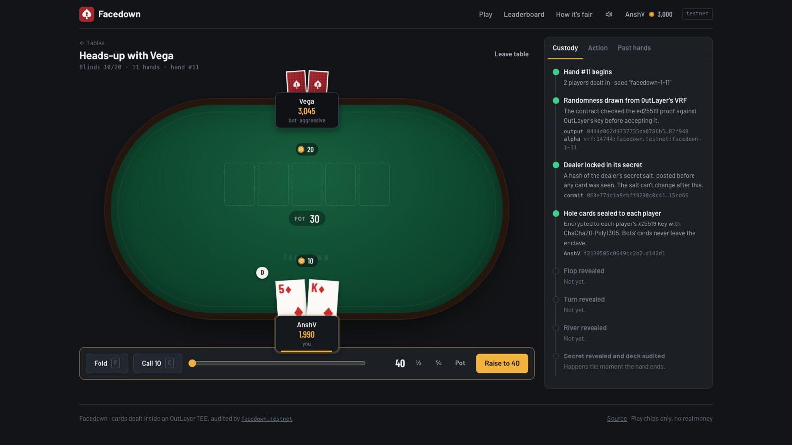
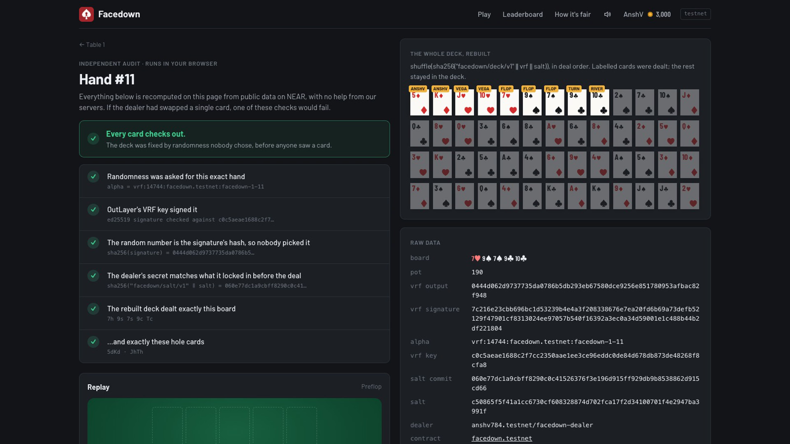
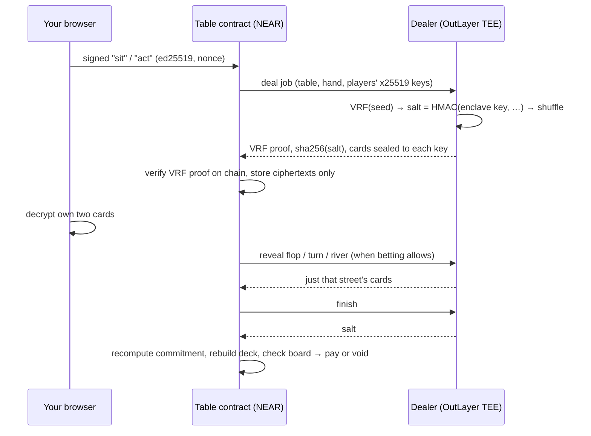

<p align="center">
  
</p>

<h1 align="center">Facedown</h1>

<p align="center">
  <b>No-limit Hold'em on NEAR where nobody can see your cards. Not the other players, not the house bots, not us.</b><br/>
  The dealer is a program sealed inside an OutLayer TEE. Every deck comes from verifiable randomness, your cards are encrypted to a key that never leaves your browser, and the contract audits every hand before a single chip moves.
</p>

<p align="center">
  <a href="https://facedown.anshverma.tech"><b>Play: facedown.anshverma.tech</b></a> ·
  contract <a href="https://testnet.nearblocks.io/address/facedown.testnet"><code>facedown.testnet</code></a> ·
  dealer <code>anshv784.testnet/facedown-dealer</code> on OutLayer
</p>


---

## The problem

Online poker runs on one assumption: the server that shuffles and deals is honest. That server knows every card.

The assumption has failed in public. In 2007 and 2008, insiders at Absolute Poker and UltimateBet used hidden "superuser" accounts that showed them every opponent's hole cards. They took millions before players caught them through impossible win rates. Every online card room since still has the same shape: one machine shuffles, deals, and sees everything.

Putting poker on a blockchain doesn't fix that by itself. A chain is public, so it can't hold a secret deck. On-chain card games either trust a server anyway, or use multi-party shuffles that take minutes per hand and need every player online to decrypt every card.

## What Facedown changes

| Who | What they can see while a hand is live |
| --- | --- |
| You | Your two cards (decrypted in your browser) and the board |
| Other players | Their own two cards |
| House bots | Their own two cards. They run inside the enclave but are only handed their own hand |
| The table contract | Ciphertexts, a commitment to a secret, a VRF proof |
| The operator (us) | Exactly what the contract sees |
| The dealer enclave | The deck. A public, hash-pinned program in Intel TDX |

When the hand ends the whole deck becomes public, and the contract checks it before anyone is paid. If a single card doesn't match, the hand is voided and every chip goes back.

## Try it in 60 seconds

1. Open **[facedown.anshverma.tech](https://facedown.anshverma.tech)**, type a name, press **Join Facedown**. You get 5,000 play chips. No wallet: your browser makes an ed25519 key (signs moves) and an x25519 key (opens your cards).
2. Pick **Heads-up with Vega** and **Sit down**. The contract asks the dealer to deal; the right panel's **Custody** tab shows the VRF proof, the salt commitment and your sealed cards arriving on chain.
3. Your two cards flip face up. That's your browser decrypting them; nobody else can.
4. Play the hand. Vega thinks inside the enclave; the flop, turn and river are revealed one street at a time.
5. At the end, click **audited on chain ✓ verify it yourself**. The page rebuilds the 52-card deck from public data and runs six checks in your browser. Press **Play** on the replay to walk the hand action by action.
6. On the **Past hands** tab, press **Audit all** to re-check every recent hand at that table at once.

Check a finished hand without the website:

```bash
near contract call-function as-read-only facedown.testnet get_hand \
  json-args '{"table":1,"hand":"2"}' network-config testnet now
near contract call-function as-read-only facedown.testnet leaderboard json-args '{}' network-config testnet now
```

<table>
  <tr>
    <td></td>
    <td></td>
  </tr>
  <tr>
    <td align="center">A live hand, with the chain of custody alongside</td>
    <td align="center">Any finished hand, re-audited in the browser</td>
  </tr>
</table>

## How a hand works



1. **Randomness nobody chose.** The dealer calls OutLayer's VRF with seed `facedown-{table}-{hand}`. The contract verifies the ed25519 proof against OutLayer's VRF key with `env::ed25519_verify`, checks `output == sha256(signature)` and checks the alpha names this exact hand. Nobody can re-roll a deck.
2. **A secret locked in before the deal.** VRF output is public, so the dealer mixes in a salt, `HMAC-SHA256(DEALER_KEY, contract | table | hand | vrf)`. `PROTECTED_DEALER_KEY` was generated inside the enclave and is readable only by this exact dealer build (OutLayer secrets locked with `--build <wasm sha256>`), so no person has ever seen it. The dealer posts `sha256("facedown/salt/v1" ‖ salt)` before any card is shown. From that moment the deck is fixed.
3. **The deck.** `shuffle(sha256("facedown/deck/v1" ‖ vrf ‖ salt))`: Fisher-Yates over a SHA-256 counter stream with rejection sampling. Player *j* gets cards `2j, 2j+1`; the board is the next five.
4. **Cards only you can open.** The dealer seals your two cards with an ephemeral X25519 key, a SHA-256 KDF and ChaCha20-Poly1305, with `facedown/{contract}/{table}/{hand}/{seat}` as associated data so a ciphertext can't be replayed into another hand or seat.
5. **Streets on demand.** Flop, turn and river are separate dealer jobs. The enclave re-derives the same deck and reveals one street, only when the contract's betting rules say it's time.
6. **Bots that play blind.** Rook (tight), Vega (aggressive) and Pip (loose) act inside the enclave. Each gets its own two cards and the public table, never the deck, and estimates its equity by Monte Carlo over the cards it can't see. The contract checks every bot move is legal.
7. **The audit, before payout.** The dealer reveals the salt. The contract recomputes the commitment, rebuilds the deck, checks the board, then scores and pays. A mismatch, or a dealer silent for five minutes, voids the hand with a full refund.

## Features

- **Real no-limit Hold'em**: 2-6 seats, blinds with heads-up rules, min-raise tracking, side pots, short all-ins that don't reopen raising, odd chips, 30-second action clock, two timeouts sit you out, `sit_in` to come back.
- **No wallet needed**: browser keypairs and a relayer whose function-call key can only call `relay` and `advance`. It can't forge a move or touch chips; every move carries the player's own signature and nonce.
- **Chain of custody panel**: every live hand shows its VRF output, salt commitment, sealed ciphertexts and each street as it lands on chain.
- **In-browser audit and replay** for every finished hand, plus **Audit all** for a whole table.
- **On-chain leaderboard** of net chips (top 20), kept by the contract itself.
- **House bots** with three styles, so a table is never empty.
- **Open your own table** with your choice of blinds, seats and bots.
- **Table sounds** (synthesized, mutable), keyboard shortcuts (F fold, C check/call, R raise), mobile layout.
- **Liveness without trust**: anyone can call `advance(table)` to start a hand, retry a stuck dealer job or play a timeout.

## Repository

```
crates/facedown-core   deck, 7-card evaluator, no-limit betting, audit   no_std    22 tests
contracts/table        NEAR contract: players, tables, hands, dealer jobs,
                       VRF verification, audit, voids, leaderboard                14 tests
dealer                 OutLayer WASI program: deal, reveal, finish, bots          9 tests
app                    React client, TypeScript port of the core, relayer         8 tests
```

The contract and the enclave run the same Rust core. The browser runs a TypeScript port that must reproduce Rust-generated vectors exactly: 6 full decks, 500 hand scores and a sealed-card vector the Rust dealer encrypted.

```bash
cargo test                                         # core + contract
cd dealer && cargo test && cargo build --release --target wasm32-wasip2
cd app && npm i && npm test && npm run dev         # /play?mock=flop shows the UI without a chain
node app/scripts/live-site.mjs 1                   # plays a real hand through the live site
```

## Deployed

| Piece | Where |
| --- | --- |
| Table contract | `facedown.testnet` |
| Dealer | OutLayer project `anshv784.testnet/facedown-dealer`, wasm `sha256 210b2ffb…3518b9` on FastFS |
| Dealer secrets | `FACEDOWN_CONTRACT`, `PROTECTED_DEALER_KEY` (generated in TEE), readable only by `facedown.testnet` **and** that wasm hash |
| VRF key | OutLayer testnet `c0c5aeae…f8cfa8` |
| Relayer | Vercel functions, function-call key limited to `relay` and `advance` |

Deploying your own:

```bash
cd contracts/table && cargo near build non-reproducible-wasm
near contract deploy <contract> use-file ../../target/near/facedown_table/facedown_table.wasm \
  with-init-call new json-args '{"owner":"<you>","dealer":{"outlayer":"outlayer.testnet","project_id":"<you>/facedown-dealer","secrets_owner":"<you>","secrets_profile":"default","vrf_pubkey":"c0c5aeae1688c2f7cc2350aae1ee3ce96eddc0de84d678db873de48268f8cfa8"}}' ...
outlayer upload dealer/target/wasm32-wasip2/release/facedown-dealer.wasm
outlayer deploy facedown-dealer <fastfs url>
outlayer secrets set '{"FACEDOWN_CONTRACT":"<contract>"}' --project <you>/facedown-dealer \
  --generate PROTECTED_DEALER_KEY:hex32 --build <wasm sha256> --access whitelist:<contract>
```

## What you still trust

- **Intel TDX** for the privacy of live cards. Not for correctness: the audit covers that. A broken enclave could leak live cards; it still couldn't change a deck without failing the audit.
- **OutLayer's VRF key**, which lives in OutLayer's own TEE.
- **Your browser** for your two keys. Back them up from the profile page.

## Limits

- Testnet and play chips only, by design.
- Every dealer step is an OutLayer job, so a street takes a few seconds and a heads-up hand about a minute and a half.
- Once a hand ends all hole cards become public, folded ones included. That is what lets anyone audit the deck.

Also built for the NEAR hackathon by the same builder: [Oathline](https://github.com/Anshv784/oathline), verifiable AI rulings for DAOs and markets.

MIT licensed.
